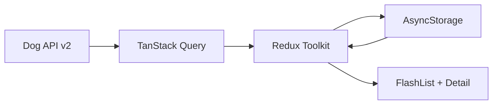

# Tripare Dog Breeds

Production-minded **Dog Breed Explorer** (React Native bare + TypeScript). Browse all 283 breeds offline-first with search, multi-filters, trait visualizations, and an attributed image gallery.

## Quick Start

```bash
npm install
cp .env.example .env

# iOS
cd ios && pod install && cd ..
npm run ios

# Android
npm run android
```

Should run in a few minutes on a machine with Xcode / Android Studio already set up.

```bash
npm test
```

## Architecture Overview

The app treats Dog API v2 as a remote source of truth and AsyncStorage as a local snapshot. On launch, cached breeds/groups hydrate Redux Toolkit immediately so the list is interactive, then TanStack Query revalidates in the background (6 paginated breed pages + groups), updates the store, and rewrites the snapshot.



Offline / partial-failure paths keep showing cached data with a clear sync banner (“Last synced …”, offline, or sync-error).

See [docs/ARCHITECTURE.md](docs/ARCHITECTURE.md) for layering details.

## Key Technical Decisions

| Area | Choice | Why |
|---|---|---|
| State | Redux Toolkit | Normalized slices, typed hooks, Immer |
| Persistence | AsyncStorage snapshot | Reliable offline MVP for 283 records |
| Sync | TanStack Query | Retry/backoff + reconnect refetch |
| List | FlashList | Heavier nested rows, not just row count |
| Nav | React Navigation | Type-safe stack for bare RN |

Full rationale: [docs/DECISIONS.md](docs/DECISIONS.md).

## Performance Report

Targets and profiling commands: [docs/PERFORMANCE.md](docs/PERFORMANCE.md).

- Bundle analysis: document prod JS bundle size after `react-native bundle`
- Profiler / memory screenshots: place under `assets/screenshots/`
- List strategy: thumb-only images + FlashList recycling for 283 rich rows

## Screenshots

Add 4–6 images under `assets/screenshots/`:

| File | Content |
|---|---|
| `list-light.png` | Breed list (light) |
| `list-dark.png` | Breed list (dark) |
| `filters.png` | Filters applied |
| `detail-traits.png` | Detail traits tab |
| `detail-gallery.png` | Gallery + attribution |
| `offline.png` | Offline / sync banner |

## Features

- Offline-first catalog after first successful sync
- Debounced search (name + other_names)
- Multi-select filters: group, size band, coat length, hypoallergenic, trait threshold
- Grouped FlashList with pull-to-refresh
- Detail tabs: Overview · Traits (visual scales) · Gallery (attribution)
- Error boundary around the root navigator

## Project layout

```
tripare-dog-breeds/
├── docs/
│   ├── ARCHITECTURE.md
│   ├── DECISIONS.md
│   └── PERFORMANCE.md
├── src/
│   ├── api/
│   ├── components/
│   ├── hooks/
│   ├── navigation/
│   ├── screens/
│   ├── storage/
│   ├── store/
│   ├── utils/
│   └── __tests__/
├── .env.example
├── App.tsx
└── package.json
```

## API

- Base: `https://dogapi.dog/api/v2` (no key)
- Breeds: paginated `page[size]=48` (6 pages)
- Groups: filter labels + list section titles
