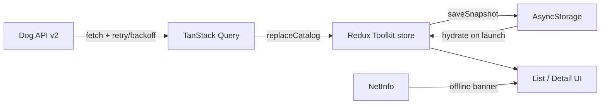

# Architecture

## Overview

Tripare Dog Breeds is an offline-first React Native (bare) app. The catalog is assembled from Dog API v2 (`/breeds` paginated at 48/page across 6 pages + `/groups`), normalized into a Redux Toolkit store, and snapshotted to AsyncStorage so the UI can render immediately on cold start.

## Data flow

1. **Hydrate** cached snapshot into Redux (non-blocking UI).
2. **Revalidate** via TanStack Query (`fetchCatalog`): merge all breed pages + groups.
3. **Persist** successful sync (`syncedAt`, breeds, groups).
4. **Partial failure**: keep cached rows and show an error banner.

## Layering

| Layer | Responsibility |
|---|---|
| `src/api` | HTTP + exponential backoff, page merge |
| `src/storage` | Versioned AsyncStorage snapshot |
| `src/store` | RTK slices: breeds catalog + filter UI state |
| `src/hooks` | Hydration, sync, connectivity |
| `src/screens` | List (FlashList) + detail tabs |
| `src/components` | Banners, rows, filters, trait bars, error boundary |

## Navigation

React Navigation native stack:

- `BreedList` → search, multi-filters, grouped FlashList, pull-to-refresh
- `BreedDetail` → Overview / Traits / Gallery (local tab switcher)

## Images

- List rows use **thumb** URLs (small payload for 283 virtualized rows).
- Gallery upgrades to **medium**.
- Attribution (author / license / source) is always shown on the gallery tab.
